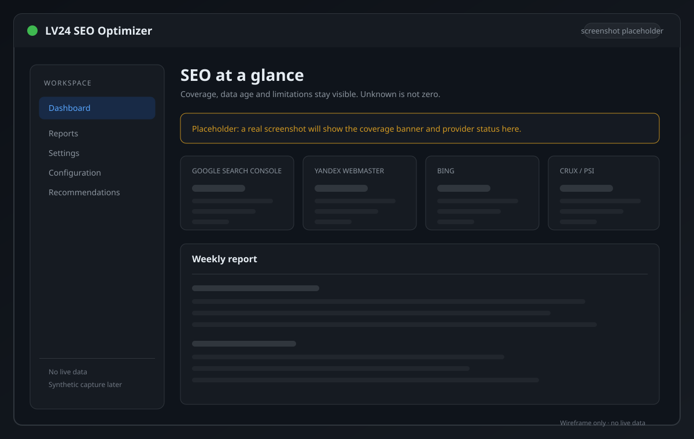

# LV24 SEO Optimizer Desktop

**A local, offline-first desktop shell for the [`lv24-seo`](https://github.com/LevapVeeskela/lv24-seo-optimizer)
engine.** Tauri v2 + React; the Python CLI remains the engine of record. No cloud account, no
telemetry, no local HTTP API, no SERP scraping.

[](LICENSE)
[](#status)
[](docs/releases/0.9.9.md)

**Docs:** [Architecture](docs/ARCHITECTURE.md) · [Agent entry](AGENTS.md) · [Engine repo](https://github.com/LevapVeeskela/lv24-seo-optimizer)

## What it is / What it is not

- **Is:** a desktop UI and an allow-listed process bridge over `lv24-seo`. It adds onboarding,
  a dashboard, crawl/report/diagnostics screens, configuration editing, backups and signed updates.
- **Is not:** a reimplementation of provider clients, crawl rules, analysis, report builders or
  delivery. It bundles a pinned engine sidecar and calls it with `--json`.
- **Is not:** a hosted service, a multi-tenant dashboard, or a source of fake precision. Missing,
  capped, delayed or failed provider data is shown as missing, capped, delayed or failed.
- **Is not:** signed or notarized by a paid certificate authority. Windows is unsigned, macOS is
  ad-hoc signed and Linux packages are unsigned.

## Status

| Item | Value |
|---|---|
| Version | `0.9.9` (2026-11-20) |
| Ship state | pre-release; published on GitHub Releases for Windows x64, Linux x64 and macOS arm64/x64 |
| Visibility | public, Apache-2.0 |
| Repo | <https://github.com/LevapVeeskela/lv24-seo-optimizer-desktop> |
| Prod | none — local app; updater manifest at `releases/latest/download/latest.json` |
| Engine | bundles `lv24-seo 0.15.3`; `MIN_ENGINE_VERSION = 0.15.3` |
| Auto-update | Windows NSIS, macOS `.app`, Linux AppImage; deb/rpm/portable ZIP are manual |

## At a glance

| Stack | Entry point | Ports | Data | Deploy |
|---|---|---|---|---|
| Tauri v2, Rust 1.90+, React 19, TypeScript, Vite, MobX | `npm run tauri dev` | Vite dev server `1420`; no local HTTP API | engine workspace `seo.toml` + SQLite | manual GitHub Releases workflow; signed updater artifacts |

## Screenshot

> **Placeholder, not live data.** The image below is a wireframe placeholder. It will be replaced by
> a real screenshot from a local workspace using synthetic data. It is not a claim that the numbers
> are real or that the UI is final.



## Install

Download from [Releases](https://github.com/LevapVeeskela/lv24-seo-optimizer-desktop/releases).
Verify `SHA256SUMS.txt` before running an installer.

| Platform | Assets | Auto-update |
|---|---|---|
| Windows 10/11 x64 | `LV24.SEO.Optimizer_0.9.9_x64-setup.exe` (+ `.exe.sig`), `LV24-SEO-Optimizer_0.9.9_x64-portable.zip` | NSIS only; portable ZIP is manual |
| Linux x64 | `LV24.SEO.Optimizer_0.9.9_amd64.AppImage` (+ `.AppImage.sig`), `.deb`, `.rpm` | AppImage only; deb/rpm are manual |
| macOS 13+ arm64/x64 | `LV24.SEO.Optimizer_0.9.9_aarch64.dmg` / `_x64.dmg`, `.app.tar.gz` (+ `.sig`) | `.app` only; DMG is the first install |

The Windows NSIS installer needs WebView2 (shipped with Windows 11 and most updated Windows 10; the
installer can fetch it). macOS uses **System Settings → Privacy & Security → Open Anyway** on first
launch. Full install notes and limitations: [`docs/releases/0.9.9.md`](docs/releases/0.9.9.md).

## Quick start (5 verified commands)

```bash
npm ci                                                   # lockfile install
npm run check                                            # typecheck + unit tests + web build
npm run dev                                              # browser shell on http://localhost:1420
npm run contract:check                                   # regenerate and fail on drift
cd src-tauri && cargo fmt --check && cargo clippy --all-targets -- -D warnings && cargo test
```

Run the desktop shell against an engine you already trust:

```bash
# bash
LV24_SEO_BIN=/absolute/path/to/lv24-seo npm run tauri dev

# Windows PowerShell
$env:LV24_SEO_BIN = "C:\path\to\lv24-seo.exe"; npm run tauri dev
```

The shell resolves `LV24_SEO_BIN`, the bundled `engine/lv24-seo/` resource, a flat `lv24-seo/`
resource, a Linux AppImage tree, or a sibling `lv24-seo/` folder. An `lv24-seo` on `PATH` is ignored
unless `LV24_SEO_ALLOW_PATH_ENGINE=1` is set. An engine older than `0.15.3` is reported as
incompatible; nothing is downloaded automatically.

## Architecture in five lines

- **Trust boundary.** The webview is untrusted input: it can invoke a fixed command table with
  validated arguments, never choose an executable, build a shell string or write outside approved
  roots. The Rust layer is the authorization boundary.
- **One envelope.** Every engine call returns `{ok, data, meta, warnings}`; the UI branches on
  `error.code`, not the exit code, and preserves unknown `meta` keys for diagnostics.
- **Engine gate.** Resolution order plus `MIN_ENGINE_VERSION` is checked before any command runs;
  an older engine is treated as offline, never silently downgraded.
- **Config writes.** Field-level `toml_edit` patch → temporary owner-only file → engine validation →
  timestamped backup (last five kept) → atomic replace and parent fsync.
- **Updates.** The webview may only check the manifest. Rust re-checks the version, verifies the
  minisign/Ed25519 signature, stops only the engine PIDs it spawned, then installs; no downgrades.

Full design: [docs/ARCHITECTURE.md](docs/ARCHITECTURE.md) · [diagrams](docs/architecture/README.md) ·
[security model](docs/security.md) · [configuration](docs/configuration.md).

## Repository map

| Path | Purpose |
|---|---|
| `src/app/`, `src/pages/` | router, layout, dashboard, reports, settings, configuration, recommendations |
| `src/features/`, `src/entities/`, `src/shared/` | Feature-Sliced Design slices; CLI transport and envelope parser in `shared` |
| `src-tauri/src/cli.rs` | allow-listed command surface, argv construction, timeouts, cancellation |
| `src-tauri/src/config.rs` | config read/validate/patch, backups, atomic replace, path checks |
| `src-tauri/src/commands.rs` | Tauri commands, engine discovery/version gate, settings |
| `src-tauri/src/paths.rs` | approved roots, canonicalization, Windows device-name rules |
| `contracts/` | generated `config.schema.json`, `cli-v1/*` fixtures, `latest.schema.json` |
| `scripts/` | sidecar build/verify, contract generation, release asset staging |
| `docs/` | architecture, configuration, security, release runbook, per-version notes |

## Releases and update channel

Releases are **manual and owner-gated** (`.github/workflows/desktop.yml`, `workflow_dispatch` only).
The workflow validates versions and the tag, builds the four targets, stages assets, merges
`latest.json` and publishes it; deb, rpm, MSI and the portable ZIP cannot replace themselves.
Updater signatures prove the artifact came from this project's release key; they are separate from
OS code signing. The updater private key is never committed or shipped. See
[`docs/release.md`](docs/release.md) for the full runbook and rollback steps.

## For AI agents

Read [AGENTS.md](AGENTS.md) first (commands, "no engine logic here", contract-drift rule, version
checklist, cargo gates), then [docs/ARCHITECTURE.md](docs/ARCHITECTURE.md) and
[docs/README.md](docs/README.md). The engine contract is generated into `contracts/`; never guess an
engine field and never hand-edit a generated fixture.

## If it helped you, star it

**[Star LevapVeeskela/lv24-seo-optimizer-desktop on GitHub](https://github.com/LevapVeeskela/lv24-seo-optimizer-desktop)**

## License

Apache-2.0. See [LICENSE](LICENSE). Provider data belongs to the property owner; this project does
not resell it.
