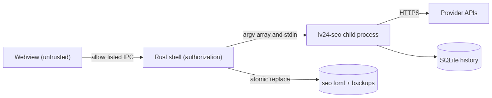
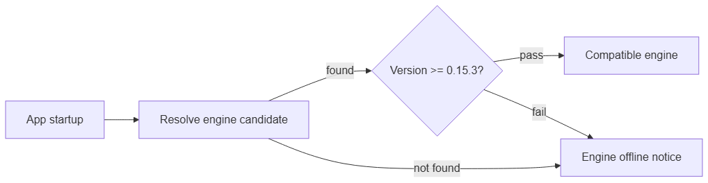
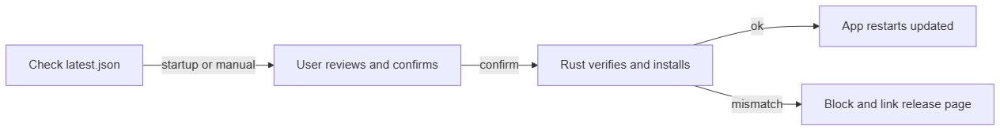

# Architecture

Status: canonical system design for **LV24 SEO Optimizer Desktop `0.9.9`** (2026-11-20). The bundled
engine is `lv24-seo 0.15.3`; `MIN_ENGINE_VERSION` is `0.15.3`. The product front door is
[`../README.md`](../README.md), the agent contract is [`../AGENTS.md`](../AGENTS.md), and the
command-by-command implementation contract is
[`architecture-details.md`](architecture-details.md). Diagram sources are in
[`architecture/`](architecture/).

## 1. Purpose and scope

The desktop is a **local, offline-first UI and process shell** over the `lv24-seo` CLI. It exists so
an operator can configure a property, run bounded reads and reports, review findings and manage
signed updates without remembering flags.

It **does**:

- provide React screens for onboarding, dashboard, crawl, logs, tasks, portfolio, reports,
  recommendations, integrations, configuration and backup;
- own the Tauri command table, path approvals, per-command timeouts and child-process lifecycle;
- patch `seo.toml` safely, validate it with the engine and keep timestamped backups;
- verify and install signed updates for the bundle types that can replace themselves.

It **does not**:

- implement provider clients, crawl rules, analysis, report builders or delivery — those stay in
  the engine and are treated as the only authority for provider semantics;
- run a local HTTP API, a hosted backend, telemetry or a job queue;
- bypass provider quotas, scrape SERPs or claim that accepted URLs are indexed.

There is no server deployment. Every process runs under the operator's OS user, and provider data
stays in the workspace the operator selected.

## 2. System context and trust boundary



| Boundary | What crosses it | Control |
|---|---|---|
| Webview → Rust | command name, validated arguments, one-time secret input | fixed command table, argument allow-lists, no executable or shell string |
| Rust → engine | argv array, optional stdin, absolute `--config`, cwd | path allow-list, `--json`, per-command timeout, exact child handle |
| Engine → provider | user credentials, queries, site URLs | engine-owned HTTP clients, rate limits, read-only defaults |
| Engine → disk | SQLite, reports, snapshots | configured data directory; the desktop does not invent paths |
| Desktop → GitHub | `latest.json`, signed update package | HTTPS, embedded minisign key, signature and version checks |

The webview is untrusted input. It can request a known operation with validated arguments; it cannot
choose an executable, construct a shell command, read arbitrary files or write outside approved
roots. The Rust layer is the authorization boundary. The engine is trusted to enforce provider
semantics and its own write gates, but it is still passed only an explicit argv array.

The webview never receives a provider token. A token entered in a password field is sent once over
IPC, piped to `lv24-seo auth set --stdin`, and then lives in the OS keychain (or the engine's
explicit file fallback). Engine `stderr` and bounded previews are redacted before truncation and
before IPC.

## 3. Runtime components

| Component | Responsibility | Entry point | Store |
|---|---|---|---|
| React webview | screens, MobX stores, envelope parsing | `src/app`, `src/pages`, `src/features` | in-memory UI state |
| Tauri shell | command surface, approvals, timeouts, cancellation | `src-tauri/src/lib.rs`, `commands.rs` | app data (`settings.json`) |
| CLI runner | argv construction, env, stdout/stderr capture | `src-tauri/src/cli.rs` | none |
| Config service | read, validate, patch, backup, atomic replace | `src-tauri/src/config.rs` | `seo.toml` + backups |
| Path service | canonicalization, approved roots, Windows device names | `src-tauri/src/paths.rs` | `knownConfigs` in settings |
| Engine sidecar | provider reads/writes, crawl, reports, SQLite, MCP | PyInstaller onedir under `engine/lv24-seo/` | workspace `data/` |
| Updater | manifest check, version/signature verification, install | Rust `update_*` commands | OS installer |

The engine exposes 25 top-level CLI commands (18 groups + 7 commands), 12 MCP tools and SQLite
schema v5. The desktop does not mirror those counts; it consumes the commands it needs through the
allow-list and regenerates `contracts/` when the pin changes.

## 4. Command bridge and the single envelope

Every engine call uses an argument array, an absolute `--config`, `--json`, a bounded timeout and
`cwd = config parent` so a relative `storage.data_dir` resolves like a terminal run. On Windows the
child is launched with `CREATE_NO_WINDOW`; `PYTHONUTF8=1` and `PYTHONIOENCODING=utf-8` keep non-ASCII
paths and text intact.

```ts
type Envelope<T> =
  | { ok: true; data: T; meta: Record<string, unknown>; warnings: string[] }
  | { ok: false; error: { code: string; message: string; next_action?: string; retryable?: boolean };
      meta: Record<string, unknown>; warnings: string[] };
```

Rules:

- `ok=false` is a typed UI error, not a crash and not a reason to guess.
- Branch on `error.code`, not the exit code. `WRITE_DISABLED`, `CONFIRM_REQUIRED` and configuration
  errors can all exit `2`.
- Preserve unknown `meta` keys for diagnostics; tolerate additive fields.
- `stdout` is JSON only; `stderr` is bounded and redacted.
- `stdout` is capped at 4 MiB and `stderr` at 128 KiB; an oversized response is an error, not a
  truncated success.
- Partial failure (`ok=true` with incomplete meta, or exit `5`) is “completed with warnings”.

The engine call surface is fixed at build time (`CliCommandId`). A desktop command maps to one
allow-listed engine invocation; a new field is accepted only by the command that owns it. The
webview cannot add a command at runtime.

Timeouts are per command: `crawl` 600 s; `auth login` 240 s (the Google loopback waits ~180 s for
consent); `stats`, `report weekly`, `report diff`, sitemap/IndexNow/Bing submit and `cwv_audits`
120 s; read-only diagnostics 60 s; `version`, `config show`, `doctor`, `properties` and
`auth status` 30 s.

Only six long local jobs are cancellable (`crawl`, `report weekly`, `logs analyze`, `backup create`,
`backup restore`, `schedule install`). A run id is a bounded cancellation handle, never a process,
path or command. `run_cancel` signals only the exact child PID registered for that run (and, on
Unix, its process group); it never matches a process by name. Cancellation is not rollback — files
already written stay on disk, and the UI says so.

## 5. Engine resolution and version gate



Resolution order:

1. `LV24_SEO_BIN` — an absolute path for development or an explicitly chosen system engine.
2. The bundled resource `engine/lv24-seo/lv24-seo[.exe]`.
3. A flat resource `lv24-seo/lv24-seo[.exe]` (portable layout).
4. A Linux AppImage tree under `$APPDIR/usr/lib/<product>/engine/lv24-seo/`; the scan is one level
   deep so it does not depend on the bundle's product name.
5. A sibling `lv24-seo/` directory next to the app (portable layout).
6. `PATH`, only when `LV24_SEO_ALLOW_PATH_ENGINE=1` is set; a stray `lv24-seo` is otherwise ignored.

Nothing is downloaded automatically. The shell runs `lv24-seo version --json`, records path, source
and version, and compares the version with `MIN_ENGINE_VERSION` (`0.15.3`). An older engine is marked
`compatible: false`; the UI treats it as offline and shows the standard notice. It does not silently
run an older engine or fake a compatibility dialog. A newer engine passes the gate but is not the
release-tested pin. Source labels are `env`, `bundled`, `bundled-flat`, `appimage`, `sibling` and
`PATH`; the portable ZIP uses a sibling/flat layout, which is how the updater knows the build cannot
replace itself.

## 6. Configuration write model

Settings forms edit a draft model. Saving:

1. builds a TOML patch with `toml_edit`, so comments and key order survive;
2. writes a temporary file next to the target and fsyncs it; on Windows the temp file gets an
   owner-only DACL (`OWNER RIGHTS`, `S-1-3-4`) before any bytes are written, and POSIX uses `0600`;
3. validates the temp file with `lv24-seo config show --config <temp> --json`;
4. creates a timestamped owner-only backup, fsynced, keeping the last five;
5. atomically replaces the target and fsyncs the parent directory;
6. re-reads and shows the effective redacted config.

Reads are bounded at 8 MiB and reject a non-regular or oversized file. Settings load per field, so
one malformed value does not discard the rest. A draft carries a revision counter: a response for an
older revision never overwrites a newer draft; the edits stay, validation is cleared and the Diff
tab shows what is still unsaved.

A workspace path is consent-gated. `pick_config` opens the native dialog, records the canonical path
as approved and returns it; `settings_set` rejects any other new path with `PATH_NOT_APPROVED`.
`knownConfigs` is written only by `pick_config` and a successful `init` (canonical, deduplicated,
capped at 20) so an earlier workspace can be re-activated after a restart without the dialog. It is
a convenience, not a bypass. `storage.data_dir` rejects UNC, verbatim and device paths
(`INVALID_PATH`) before they are resolved, avoiding outbound SMB authentication.

There is no raw TOML editor. Reserved engine fields are labelled **no effect**, never presented as
working controls. Token values are never persisted by the webview, logged or shown back.

## 7. Provider writes and local-state runs

The engine owns the two-phase write gate: plan → confirm token → pending claim → provider call →
`sent` or release. CLI and MCP share the same gate, `LV24_SEO_WRITE_SECRET` and SQLite idempotency
ledger. The desktop generates a fresh 32-byte hex secret at startup with the OS CSPRNG, keeps it in
Rust memory only and sets it on every child after `env_clear()`. A new session invalidates old plan
tokens, so the UI re-plans.

Sitemap submit, IndexNow and Bing URL submit expose the same two shapes: a plan call with
`--allow-write` (which mints the reviewed token, but does not write to the provider) and an apply
call with `--confirm <token>`. The shell rejects a write flag on a read command and a read-only flag
on a write command before the engine is spawned. Success means the provider **accepted** the URLs,
not that they are indexed.

Local-state tools (`seo_crawl_site`, `seo_weekly_report`) are not write-gated because they never
mutate provider state; they carry `readOnlyHint: false` and `writes_local_state: true`. A cancelled
crawl or report may leave a partial local artifact; a cancelled restore may have replaced one of the
database or config files, and the engine keeps its pre-restore copy.

## 8. Updates



The updater endpoint is
`https://github.com/LevapVeeskela/lv24-seo-optimizer-desktop/releases/latest/download/latest.json`.
The app checks it once at startup (silently, 30-second timeout) and on **Check for updates**.

The webview has only `updater:allow-check`; it cannot call `downloadAndInstall`. The install runs in
Rust, which:

- re-checks the endpoint and refuses a version that differs from the one shown
  (`UPDATE_VERSION_MISMATCH`);
- serializes one install at a time (`UPDATE_IN_PROGRESS`);
- verifies the minisign/Ed25519 signature; `requireSignedVersion` binds the announced version to the
  signed package, and a signature failure blocks that artifact without retry;
- refuses a version that is not greater than the running one (no downgrades);
- stops only the engine PIDs this app instance spawned before handing the bytes to the installer;
  if a sidecar cannot be stopped, the install is blocked with `UPDATE_ENGINE_BUSY`;
- never downloads or installs on its own — the user confirms, and **Cancel** stops the download
  before installation starts (`UPDATE_CANCELLED`). Once installation begins, the app says it cannot
  be undone instead of pretending the click cancelled it.

Windows runs the signed NSIS setup in passive mode, macOS replaces the `.app`, Linux replaces the
AppImage. deb, rpm, MSI and the portable ZIP cannot replace the running installation; the UI
disables the in-app installer and links to the release page. The updater private key is used only by
the release build and is never committed, shipped or given to a normal build.

## 9. Deployment and release pipeline

The desktop is not deployed to a server. It is built and published as OS bundles from a **manual,
owner-gated** GitHub Actions workflow (`.github/workflows/desktop.yml`, `workflow_dispatch` only; no
push, PR or tag trigger). The workflow validates that `package.json`, `tauri.conf.json` and
`Cargo.toml` agree and that a release tag points at the built commit, then builds the four targets:
Windows x64, Linux x64, macOS arm64 and macOS x64.

Assets per release: NSIS setup + signature, portable ZIP, AppImage + signature, deb, rpm, both DMGs,
both `.app.tar.gz` + signatures, `latest.json` and `SHA256SUMS.txt`. HSMs and paid runners are not
used; the default path is free-tier only. The sidecar is a PyInstaller **onedir** tree, so each
target is built on its own host; PyInstaller does not cross-compile and output is not
byte-reproducible. The committed pin records the reviewed local build where one exists, CI records
the rebuilt checksum, and the release gate requires a valid checksum report for every shipped target.

Rollback is a manual install of an older release; there are no downgrades through the updater. The
full procedure, asset gates and rollback steps live in [`release.md`](release.md).

## 10. Data ownership

| Data | Location | Owner / retention |
|---|---|---|
| Engine workspace | operator-chosen `seo.toml` + `data/seo.sqlite3` | engine; history and snapshots stay local |
| App settings | OS app-data `settings.json` | desktop; workspace list, window preferences |
| Config backups | next to `seo.toml` (`<config>.bak-*`) | desktop; last five, only names it wrote |
| Exports | app-data `exports/` | desktop; reports and backup archives |
| Secrets | OS keychain (or engine file fallback) | engine; never in settings, argv or logs |
| Update manifest | GitHub Releases | project; public, no user data |

The desktop never uploads provider data. The only automatic network request is the updater's
`latest.json` check; diagnostics copies are user-triggered and redacted.

## 11. Invariants and failure modes

- **No engine logic in this repo.** A provider field, crawl rule or report section belongs to the
  engine. The desktop may format, explain and gate it; it may not invent or recompute it.
- **No local HTTP API.** A future local API needs an explicit design with its own authentication and
  loopback binding; it is not part of the current architecture.
- **No telemetry and no cloud account.** Strict production CSP allows local assets and Tauri IPC
  only; `connect-src` is IPC, not the internet.
- **No arbitrary paths or executables.** A new workspace path comes only from the native dialog; a
  log file or backup archive is read only after its picker approved it. Windows reserved device
  names and trailing dots/spaces are rejected in every path component.
- **Provider failure is isolated.** A failed source is named; the rest of a report still renders.
  A missing token is configuration, not an outage. A no-data report is neutral, not an error.
- **Partial success is labelled.** Exit `5` or incomplete meta is “completed with warnings”, never a
  clean success. The UI does not zero-fill a provider-empty answer.
- **Blocking work has a deadline.** Config and backup file work runs off the UI thread with
  `PATH_TIMEOUT`; a dead network share cannot freeze the window. The blocking task itself cannot be
  aborted, so its thread survives a timeout.
- **Cancellation is exact.** Only the recorded child PID (and its group) is signalled, never a
  process matched by name.

## 12. Extension points

- **New screen:** add a page under `src/pages/` and a feature slice under `src/features/`, keeping
  one public API per slice; screens never parse raw process output.
- **New engine read:** add a `CliCommandId` variant with a short argument allow-list, map it through
  `cli.rs`, then add the fixture to `contracts/cli-v1/` via `node scripts/check-contracts.mjs
  --update`. A command without a fixture is not a contract.
- **New write:** it must reuse the engine's two-phase gate. The desktop appends `--allow-write` only
  after the user confirms and `--confirm` only with the plan token; it never mints a token itself.
- **New provider:** not here. Add the adapter to `lv24-seo`, then bump the pin and regenerate
  contracts; the desktop only renders what the engine returns.
- **New bundle type:** update `desktop.yml`, the asset gate and `docs/release.md` together, or the
  release will publish an asset the updater cannot verify.

## 13. Related repos and decisions

- Engine: <https://github.com/LevapVeeskela/lv24-seo-optimizer> — provider adapters, crawl rules,
  reports, write gate, SQLite schema. Desktop `0.9.9` pins engine `0.15.3`.
- Public docs portal: <https://seo.lv24.by/> — install, engine/desktop architecture and release
  pages in en/ru/zh.
- Contracts: [`../contracts/README.md`](../contracts/README.md) — generated schema and CLI fixtures.
- Release runbook: [`release.md`](release.md) · security model: [`security.md`](security.md) ·
  configuration reference: [`configuration.md`](configuration.md).
- Brain project: `lv24-seo-optimizer-desktop` — durable decisions, attempts and handoffs.
